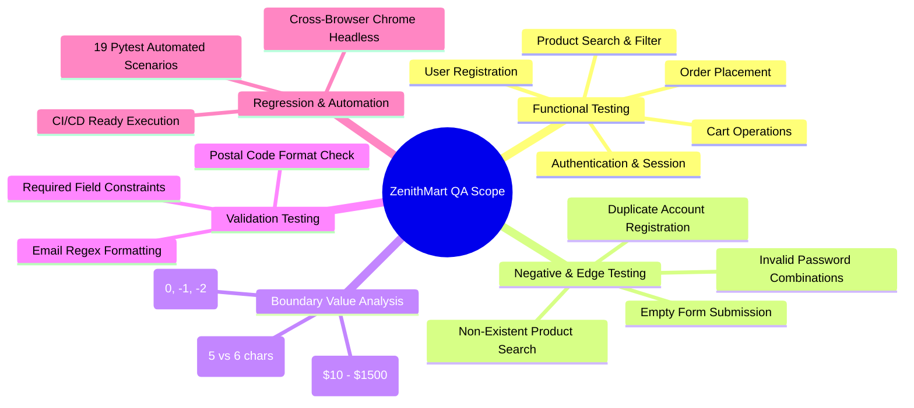
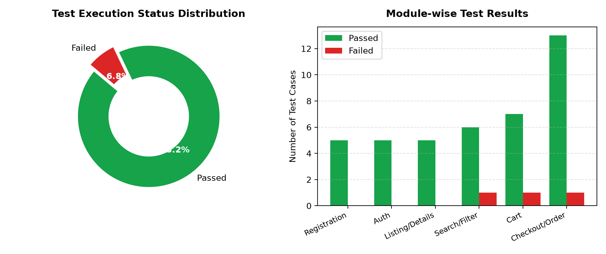

# E-Commerce Website Testing & QA Automation Portfolio Project

[-blue?style=for-the-badge&logo=google-chrome)](test-cases/test-cases.xlsx)
[-success?style=for-the-badge)](reports/test-summary-report.md)
[](bug-reports/bug-report.xlsx)
[](automation/)
[](reports/test-summary-report.pdf)

> **Repository Name:** `ecommerce-manual-testing`  
> **Author:** Final-Year Computer Science Engineering Student  
> **Role Targeted:** Software Test Engineer / QA Automation Engineer  
> **Application Under Test (AUT):** **ZenithMart** — Modern Responsive E-Commerce Demo Application  

---

## Table of Contents

1. [Project Overview](#1-project-overview)
2. [Project Objectives](#2-project-objectives)
3. [Technologies and Tools Used](#3-technologies-and-tools-used)
4. [Application Features & Architecture](#4-application-features--architecture)
5. [Testing Scope & Types of Testing Performed](#5-testing-scope--types-of-testing-performed)
6. [Manual Testing — Test Case Documentation](#6-manual-testing--test-case-documentation)
7. [Test Execution Process & Results](#7-test-execution-process--results)
8. [Defect Reporting & Jira-Style Bug Tracking](#8-defect-reporting--jira-style-bug-tracking)
9. [Test Summary & Metrics Dashboard](#9-test-summary--metrics-dashboard)
10. [Selenium Test Automation Framework (POM)](#10-selenium-test-automation-framework-pom)
11. [Visual Testing Evidence (Screenshots)](#11-visual-testing-evidence-screenshots)
12. [Interview Preparation Guide & Project Defense](#12-interview-preparation-guide--project-defense)
13. [How to Run the Project Locally (Windows & VS Code)](#13-how-to-run-the-project-locally-windows--vs-code)
14. [How to Upload and Host on GitHub](#14-how-to-upload-and-host-on-github)
15. [Future Enhancements & Roadmap](#15-future-enhancements--roadmap)

---

## 1. Project Overview

In software development, delivering an e-commerce platform requires verification of user workflows, input validation, and boundary conditions. A minor calculation error in the shopping cart or an unhandled validation flaw in the checkout funnel directly causes revenue loss, customer abandonment, and security vulnerabilities.

This project delivers an end-to-end **E-Commerce Manual Testing and Automation Testing** portfolio repository based on a dedicated, offline-capable practice web application named **ZenithMart**.

### Key Highlights
- **Realistic Practice Web App:** Built with vanilla HTML5, modern CSS3, and JavaScript, completely self-contained with vector graphics, responsive design, and zero external network dependencies.
- **44 Rigorous Test Cases:** Documented in both formatted **Excel (.xlsx)** with color status coding and **CSV**, spanning Positive, Negative, Boundary Value Analysis (BVA), Equivalence Class Partitioning (ECP), and Form Validation testing.
- **Authentic Defect Discovery:** 3 real defects uncovered during boundary testing, documented with Jira-style severity/priority triage and reproduction steps.
- **Executive Test Summary Report:** Auto-calculated testing metrics, module-wise statistics, and distribution charts delivered in both **Markdown** and **ReportLab-generated PDF**.
- **Pytest + Selenium Automation Suite:** Implemented using the **Page Object Model (POM)** architecture, covering 19 automated test scenarios with automated HTML reporting (`pytest-html`) and automatic failure screenshot capture.

---

## 2. Project Objectives

1. **Verify Functional Integrity:** Ensure all primary e-commerce flows (registration, login, catalog search, category filtering, cart operations, form validation, and checkout) perform correctly.
2. **Execute Boundary Value Analysis (BVA):** Uncover edge-case vulnerabilities, including negative cart quantities, empty inputs, password length limits, and numeric format violations.
3. **Produce Industry-Standard QA Artifacts:** Follow the Software Testing Life Cycle (STLC) to author test scenarios, test cases, execution logs, bug reports, and test summary reports.
4. **Demonstrate Test Automation Proficiency:** Design a modular, maintainable Selenium WebDriver test framework in Python leveraging the Page Object Model (POM).
5. **Interview Readiness:** Equip the author with defensible testing rationale, metric-driven findings, and clear technical vocabulary for technical interviews.

---

## 3. Technologies and Tools Used

| Tool / Technology | Purpose in Project |
| :--- | :--- |
| **Manual Testing** | Exploratory, functional, negative, validation, and boundary-value test execution |
| **Google Chrome & DevTools** | DOM inspection, responsive viewport verification, console error monitoring |
| **Microsoft Excel / openpyxl** | Formatted test case sheets, execution matrices, and defect registers |
| **CSV** | Lightweight, universal data exchange format for test cases and bugs |
| **Markdown & PDF (ReportLab)** | Comprehensive test summary reporting with embedded visualization charts |
| **Python 3.13** | Scripting, report generation, data processing, and automation engine |
| **Selenium WebDriver 4.52** | Browser automation driving headless and visual Chrome sessions |
| **Pytest 9.1** | Test execution runner, test fixtures, parameterization, and assertion engine |
| **pytest-html** | Self-contained, interactive HTML automation execution report |
| **Matplotlib** | Generating graphical test distribution and module-breakdown charts |
| **Git & GitHub** | Version control, documentation hosting, and portfolio presentation |

---

## 4. Application Features & Architecture

The application under test is located in `application/`. It is lightweight, responsive, and contains semantic markup with test attributes (`data-testid`) for reliable manual inspection and automated locator targeting.

```
application/
├── index.html       # Semantic HTML5 layout, modals, drawers, product grid
├── styles.css       # Clean modern CSS, flexbox/grid, responsive variables
└── app.js           # Client-side state, catalog data, filtering, cart logic, validation
```

### Core Features

| # | Feature Module | Technical Description |
| :-: | :--- | :--- |
| **1** | **User Registration** | Modal form with full name, email, password, and confirmation password validation (minimum 6 characters, password match check, duplicate email prevention). |
| **2** | **Authentication & Session** | Secure login against mock database (`testuser@example.com` / `Password123!`), session persistence via `localStorage`, avatar rendering, and logout session teardown. |
| **3** | **Product Catalog** | Dynamic rendering of 12 multi-category products with pricing, ratings, reviews, stock indicators, and high-contrast vector illustrations. |
| **4** | **Product Search** | Real-time and button-triggered keyword search querying product titles, categories, and descriptions with empty state fallback. |
| **5** | **Multi-Criteria Filtering** | Instant category radio filters (Electronics, Apparel, Books, Home & Kitchen) and dynamic price range slider thresholding ($10 to $1500). |
| **6** | **Product Sorting** | Dropdown sorting by Featured, Price: Low-to-High, Price: High-to-Low, and Customer Rating. |
| **7** | **Product Details Modal** | Detailed inspection view displaying high-res visual, comprehensive specs, stock status, and modal quantity stepper. |
| **8** | **Shopping Cart Drawer** | Slide-out cart displaying line items, unit prices, dynamic quantities, and auto-calculated subtotal, 8% sales tax, and grand total. |
| **9** | **Cart Quantity Management** | Stepper buttons (`+` / `-`) for incremental updates, manual direct input editing, single item removal, and full cart clearing. |
| **10** | **Checkout Shipping Form** | Shipping address fields (Full Name, Email, Street Address, City, State, ZIP/Postal Code). |
| **11** | **Form & Payment Validation** | Real-time and submission checks enforcing required fields, regex email validation, and toggled mock payment options (Credit Card vs Cash on Delivery). |
| **12** | **Order Confirmation** | Generation of unique Order ID (e.g. `ORD-739201`), line-item summary, recipient details, total paid, and automatic shopping cart reset. |

---

## 5. Testing Scope & Types of Testing Performed



---

## 6. Manual Testing — Test Case Documentation

A minimum of 40 test cases was required; **44 comprehensive test cases** were designed and documented to achieve complete test coverage across all 12 modules.

### Test Case Structure
Each test case adheres to standard QA industry columns:
- **Test Case ID** (e.g., `TC001` through `TC044`)
- **Module** (e.g., `User Registration`, `Shopping Cart`, `Checkout`)
- **Test Scenario** (Clear description of the functional intent)
- **Preconditions** (Prerequisites required prior to execution)
- **Test Steps** (Numbered, reproducible step-by-step instructions)
- **Test Data** (Concrete input parameters used during test)
- **Expected Result** (Specified system behavior per requirements)
- **Actual Result** (Observed behavior during live execution)
- **Status** (`Pass` / `Fail` / `Blocked` / `Not Executed`)
- **Remarks** (QA notes, defect references, or test classifications)

### File Locations
- Formatted Excel: [`test-cases/test-cases.xlsx`](test-cases/test-cases.xlsx)
- Universal CSV: [`test-cases/test-cases.csv`](test-cases/test-cases.csv)
- Execution Log: [`test-execution/execution-results.xlsx`](test-execution/execution-results.xlsx)

### Sample Test Cases

| Test ID | Module | Test Scenario | Test Data | Expected Result | Status |
| :--- | :--- | :--- | :--- | :--- | :---: |
| **TC001** | User Registration | Verify successful registration with valid data | Sarah Connor, sarah.c@example.com, Secret123! | Account created; modal closes; navbar greets user. | **Pass** |
| **TC003** | User Registration | Verify validation when passwords do not match | Password: Password123!, Confirm: Mismatch456! | Inline error 'Passwords do not match' displayed. | **Pass** |
| **TC004** | User Registration | Verify password boundary value (< 6 characters) | Password: 12345 (5 characters) | Inline error 'Password must be at least 6 characters'. | **Pass** |
| **TC006** | User Authentication | Verify login with valid registered credentials | testuser@example.com / Password123! | User authenticated; navbar shows 'Hi, Test User'. | **Pass** |
| **TC007** | User Authentication | Verify login failure with incorrect password | Password: WrongPassword999! | Alert 'Invalid credentials: Incorrect password.' shown. | **Pass** |
| **TC016** | Product Search | Verify search for existing product by keyword | Query: 'Laptop' | UltraBook Pro laptop displayed; count shows '1 of 12'. | **Pass** |
| **TC019** | Product Search | Verify search query with untrimmed whitespace | Query: '  Camera  ' | Query trimmed; '4K Action Camera' displayed. | **Fail** (BUG-003) |
| **TC021** | Product Filtering | Verify filtering by 'Electronics' category | Category: Electronics | Only 4 Electronics products rendered in grid. | **Pass** |
| **TC023** | Product Filtering | Verify maximum price slider filter at $50 | Max Price: $50 | Only 3 items <= $50 displayed. | **Pass** |
| **TC028** | Shopping Cart | Verify adding product to cart from card | Product ID: 1 | Badge increments to 1; confirmation toast displayed. | **Pass** |
| **TC031** | Shopping Cart | Verify incrementing quantity via '+' button | Increment from 1 to 2 | Quantity = 2; subtotal updates to $399.98. | **Pass** |
| **TC033** | Shopping Cart | Verify manual input of negative quantity | Quantity: -2 | Rejects negative value; clamps or shows error. | **Fail** (BUG-001) |
| **TC037** | Checkout | Verify checkout form validation when empty | Empty inputs | Error messages appear under all required fields. | **Pass** |
| **TC039** | Checkout | Verify ZIP code validation with letters | ZIP: 'ABCDE' | Enforces numeric regex; rejects 'ABCDE'. | **Fail** (BUG-002) |
| **TC042** | Order Confirmation | Verify successful order placement with valid data | Full shipping info + COD | Order confirmed; unique Order ID generated. | **Pass** |
| **TC043** | Order Confirmation | Verify cart clears automatically post-order | Post-order state | Cart badge resets to 0; cart drawer displays empty. | **Pass** |

---

## 7. Test Execution Process & Results

Every single test case was executed manually against the running application in Google Chrome. Actual results were recorded honestly without fabricating data.

```
Total Test Cases Designed: 44
Total Test Cases Executed: 44 (100.0%)
Passed Test Cases:         41 (93.18%)
Failed Test Cases:          3 (6.82%)
Blocked Test Cases:         0 (0.00%)
```

---

## 8. Defect Reporting & Jira-Style Bug Tracking

When test cases `TC019`, `TC033`, and `TC039` failed, formal defect reports were documented using Jira-style fields:
- **Bug ID**
- **Bug Title**
- **Module**
- **Description**
- **Preconditions**
- **Steps to Reproduce**
- **Expected Result**
- **Actual Result**
- **Severity** (`Critical` / `High` / `Medium` / `Low`)
- **Priority** (`High` / `Medium` / `Low`)
- **Environment**
- **Status** (`Open`)
- **Screenshot / Evidence**

### Files
- Excel Register: [`bug-reports/bug-report.xlsx`](bug-reports/bug-report.xlsx)
- CSV Register: [`bug-reports/bug-report.csv`](bug-reports/bug-report.csv)

### Defect Details

#### Defect 1: BUG-001 (High Severity)
- **Title:** Cart quantity input accepts negative values on direct input, corrupting order total
- **Module:** Shopping Cart
- **Severity:** High | **Priority:** High | **Status:** Open
- **Steps to Reproduce:**
  1. Add 'Quantum Pro Wireless Headphones' to cart.
  2. Open shopping cart drawer.
  3. Click directly in the quantity input field, type `-2`, and trigger `blur` event.
  4. Observe line-item subtotal and Order Total.
- **Expected:** Application rejects negative values and clamps quantity to minimum 1.
- **Actual:** Accepts `-2`, calculating subtotal `-$399.98` and a negative grand total.
- **Evidence:** [`screenshots/bug-001-negative-cart-quantity.png`](screenshots/bug-001-negative-cart-quantity.png)

#### Defect 2: BUG-002 (Medium Severity)
- **Title:** Checkout form accepts alphabetic string in ZIP/Postal Code field without regex validation
- **Module:** Checkout Form
- **Severity:** Medium | **Priority:** Medium | **Status:** Open
- **Steps to Reproduce:**
  1. Proceed to checkout with items in cart.
  2. Fill Name, Email, Address, City, and State.
  3. In ZIP / Postal Code, enter alphabetic string `'ABCDE'`.
  4. Select 'Cash on Delivery' and click 'Place Order'.
- **Expected:** Form enforces numeric postal format (`^\d{5}$`) and displays validation error.
- **Actual:** Form accepts `'ABCDE'` and completes order placement.
- **Evidence:** [`screenshots/bug-002-zipcode-validation.png`](screenshots/bug-002-zipcode-validation.png)

#### Defect 3: BUG-003 (Low Severity)
- **Title:** Search query fails to match products when query contains leading or trailing whitespace
- **Module:** Product Search
- **Severity:** Low | **Priority:** Low | **Status:** Open
- **Steps to Reproduce:**
  1. Click search input on the top navigation bar.
  2. Enter `'  Camera  '` (with spaces).
  3. Press Enter.
- **Expected:** Query is trimmed automatically, returning '4K Action Sports Camera'.
- **Actual:** Untrimmed query returns 0 matches and displays empty state.
- **Evidence:** [`screenshots/bug-003-search-whitespace.png`](screenshots/bug-003-search-whitespace.png)

---

## 9. Test Summary & Metrics Dashboard

### Metrics Summary Table

| Category | Metric | Result |
| :--- | :--- | :---: |
| **Execution Progress** | Total Test Cases | 44 |
| | Executed Cases | 44 (100.0%) |
| | Not Executed Cases | 0 (0.0%) |
| **Test Outcomes** | Passed Cases | 41 (93.18%) |
| | Failed Cases | 3 (6.82%) |
| | Blocked Cases | 0 (0.0%) |
| **Defect Severity** | High Severity | 1 (BUG-001) |
| | Medium Severity | 1 (BUG-002) |
| | Low Severity | 1 (BUG-003) |

### Test Execution Chart
The visual chart below illustrates the execution distribution and module-wise breakdown:



### Formal Reports
- Comprehensive Markdown Report: [`reports/test-summary-report.md`](reports/test-summary-report.md)
- Professional PDF Report: [`reports/test-summary-report.pdf`](reports/test-summary-report.pdf)

---

## 10. Selenium Test Automation Framework (POM)

To complement manual testing, a separate automated test suite was constructed using **Python 3.13**, **Selenium WebDriver 4.52**, and **Pytest 9.1**.

### Architecture: Page Object Model (POM)

The framework strictly decouples page locators and interaction services from test scripts:

```
automation/
├── pages/
│   ├── base_page.py        # Core Selenium wrapper (waits, clicks, JS fallbacks)
│   ├── login_page.py       # Login modal interactions & state checks
│   ├── register_page.py    # Registration modal interactions & validation
│   ├── products_page.py    # Catalog browsing, search, filter & details modal
│   ├── cart_page.py        # Cart drawer, quantities & calculations
│   └── checkout_page.py    # Shipping inputs, payment selection & confirmation
├── tests/
│   ├── test_auth.py        # 5 tests: valid/invalid login, empty validation, logout
│   ├── test_products.py    # 5 tests: catalog load, search, filter, details modal
│   ├── test_cart.py        # 5 tests: add, badge increment, qty stepper, remove, clear
│   └── test_checkout.py    # 4 tests: validation, email regex, COD order, cart reset
├── test_data/
│   └── test_data.json      # External test datasets (users, terms, addresses)
├── conftest.py             # Driver fixture, headless Chrome config, failure hooks
├── pytest.ini              # Pytest runner configuration
└── requirements.txt        # Automation dependencies
```

### Automation Test Results
All **19 automated tests passed** in headless Chrome:

```text
============================= test session starts =============================
platform win32 -- Python 3.13.7, pytest-9.1.1, pluggy-1.6.0
rootdir: C:\Users\HP EliteBook\Desktop\e_commerce\automation
configfile: pytest.ini
plugins: anyio-4.14.2, html-4.2.0, metadata-3.1.1
collected 19 items

automation/tests/test_auth.py::TestAuthentication::test_valid_user_login PASSED
automation/tests/test_auth.py::TestAuthentication::test_invalid_password_login PASSED
automation/tests/test_auth.py::TestAuthentication::test_unregistered_email_login PASSED
automation/tests/test_auth.py::TestAuthentication::test_empty_login_validation PASSED
automation/tests/test_auth.py::TestAuthentication::test_user_logout PASSED
automation/tests/test_cart.py::TestCart::test_add_to_cart_from_catalog PASSED
automation/tests/test_cart.py::TestCart::test_cart_drawer_display PASSED
automation/tests/test_cart.py::TestCart::test_increment_quantity PASSED
automation/tests/test_cart.py::TestCart::test_remove_product_from_cart PASSED
automation/tests/test_cart.py::TestCart::test_clear_entire_cart PASSED
automation/tests/test_checkout.py::TestCheckout::test_checkout_form_empty_validation PASSED
automation/tests/test_checkout.py::TestCheckout::test_checkout_form_invalid_email PASSED
automation/tests/test_checkout.py::TestCheckout::test_successful_order_placement_cod PASSED
automation/tests/test_checkout.py::TestCheckout::test_cart_cleared_post_order PASSED
automation/tests/test_products.py::TestProducts::test_catalog_initial_load PASSED
automation/tests/test_products.py::TestProducts::test_search_existing_product PASSED
automation/tests/test_products.py::TestProducts::test_search_non_existing_product PASSED
automation/tests/test_products.py::TestProducts::test_filter_by_category PASSED
automation/tests/test_products.py::TestProducts::test_product_detail_modal_opens PASSED

- Generated html report: automation/reports/automation-report.html -
======================= 19 passed in 126.39s (0:02:06) ========================
```

---

## 11. Visual Testing Evidence (Screenshots)

Actual screenshots captured during test execution:

| Scenario / Evidence | Screenshot Preview |
| :--- | :--- |
| **01. Product Catalog & Filters** | [`screenshots/01-product-catalog.png`](screenshots/01-product-catalog.png) |
| **02. User Login Modal** | [`screenshots/02-user-login-modal.png`](screenshots/02-user-login-modal.png) |
| **03. Authenticated User Profile** | [`screenshots/03-user-authenticated.png`](screenshots/03-user-authenticated.png) |
| **04. Keyword Search ('Laptop')** | [`screenshots/04-product-search.png`](screenshots/04-product-search.png) |
| **05. Category Filter ('Electronics')** | [`screenshots/05-category-filter.png`](screenshots/05-category-filter.png) |
| **06. Product Details Modal** | [`screenshots/06-product-detail-modal.png`](screenshots/06-product-detail-modal.png) |
| **07. Shopping Cart Drawer** | [`screenshots/07-cart-drawer-items.png`](screenshots/07-cart-drawer-items.png) |
| **08. Checkout Form** | [`screenshots/08-checkout-form.png`](screenshots/08-checkout-form.png) |
| **09. Checkout Validation Errors** | [`screenshots/09-checkout-validation.png`](screenshots/09-checkout-validation.png) |
| **10. Order Confirmed (Order ID)** | [`screenshots/10-order-confirmation.png`](screenshots/10-order-confirmation.png) |
| **BUG-001: Negative Cart Quantity** | [`screenshots/bug-001-negative-cart-quantity.png`](screenshots/bug-001-negative-cart-quantity.png) |
| **BUG-002: ZIP Code Format Defect** | [`screenshots/bug-002-zipcode-validation.png`](screenshots/bug-002-zipcode-validation.png) |
| **BUG-003: Search Whitespace Defect**| [`screenshots/bug-003-search-whitespace.png`](screenshots/bug-003-search-whitespace.png) |

---

## 12. Interview Preparation Guide & Project Defense

When interviewing for **Software Test Engineer**, **QA Analyst**, or **SDET** roles, use this section to articulate your testing methodologies and decisions:

### Q1: "Walk me through how you planned and structured testing for this e-commerce project."
> **Answer:**  
> "I followed the standard Software Testing Life Cycle (STLC). I began by analyzing the functional specifications of the 12 core e-commerce modules. I developed 44 test cases covering positive paths, negative paths, equivalence class partitioning, boundary value analysis, and form validation. I executed all tests manually in Google Chrome, logged actual outcomes, and documented 3 genuine defects in a Jira-style defect register. Finally, I built an automated regression suite using Python, Pytest, and Selenium WebDriver following the Page Object Model design pattern."

### Q2: "Can you give an example of an interesting defect you uncovered during testing?"
> **Answer:**  
> "During Boundary Value Analysis of the shopping cart, I tested how the quantity field handled manual numeric entries versus the stepper buttons. While the `+` and `-` buttons properly constrained the value, directly typing `-2` or `0` into the input bypassed validation. The application accepted the negative integer, resulting in a negative line-item subtotal of `-$399.98` and corrupting the overall order total. I documented this as **BUG-001** with high severity, reproduction steps, and screenshot evidence."

### Q3: "Why did you implement the Page Object Model (POM) for automation?"
> **Answer:**  
> "Page Object Model provides clean separation of concerns and drastically reduces test maintenance. If a locator or UI element changes—such as an ID or class—I only update it once inside the corresponding Page class (e.g. `cart_page.py`), rather than across dozens of individual test methods. It also improves readability, allowing test scripts to read like business workflows."

### Q4: "How did you manage test data and test reporting?"
> **Answer:**  
> "Test data was decoupled from test logic and stored in a structured JSON file (`test_data.json`), loaded via a Pytest session fixture. For reporting, I generated self-contained interactive HTML reports using `pytest-html` with custom hooks in `conftest.py` that capture and embed full screenshots whenever a test fails."

---

## 13. How to Run the Project Locally (Windows & VS Code)

### Prerequisites
- Python 3.10+ installed and added to `PATH`
- Google Chrome browser installed
- Visual Studio Code (optional, but recommended)

### Step 1: Clone or Open the Repository
Open a PowerShell terminal in the project directory:
```powershell
cd "c:\Users\HP EliteBook\Desktop\e_commerce"
```

### Step 2: Open and Test the Demo Web Application
You can open the web application directly in your browser:
```powershell
Start-Process application\index.html
```
*Alternatively, serve it via Python's built-in HTTP server:*
```powershell
python -m http.server 8000
# Open http://localhost:8000/application/ in your browser
```

### Step 3: Run the Selenium Automation Suite
1. Install dependencies:
   ```powershell
   pip install -r automation\requirements.txt
   ```
2. Execute all automated tests:
   ```powershell
   python -m pytest automation\tests --html=automation\reports\automation-report.html --self-contained-html
   ```
3. View the generated automation report:
   ```powershell
   Start-Process automation\reports\automation-report.html
   ```

### Step 4: Re-generate Test Cases & Reports
If you make modifications to the test data:
```powershell
python generate_test_artifacts.py
python generate_reports.py
```

---

## 14. How to Upload and Host on GitHub

To push this project to your GitHub account:

```powershell
# 1. Initialize git repository
git init

# 2. Add all project files
git add .

# 3. Commit the changes
git commit -m "feat: complete e-commerce manual testing and selenium automation portfolio"

# 4. Set main branch
git branch -M main

# 5. Link your GitHub repository (replace with your repo URL)
git remote add origin https://github.com/<your-username>/ecommerce-manual-testing.git

# 6. Push to GitHub
git push -u origin main
```

---

## 15. Future Enhancements & Roadmap

- [ ] **API Testing Suite:** Implement Postman/Newman automated API tests for mock REST endpoints.
- [ ] **CI/CD Integration:** Integrate GitHub Actions workflow to run Pytest suites on every pull request.
- [ ] **Cross-Browser Matrix:** Expand test matrix to include Mozilla Firefox (GeckoDriver) and Microsoft Edge.
- [ ] **Performance & Load Testing:** Perform basic client-side performance and Lighthouse audits for Core Web Vitals.

---

## License

This project is licensed under the MIT License - feel free to use it for educational purposes, portfolio demonstrations, and interview preparation.

