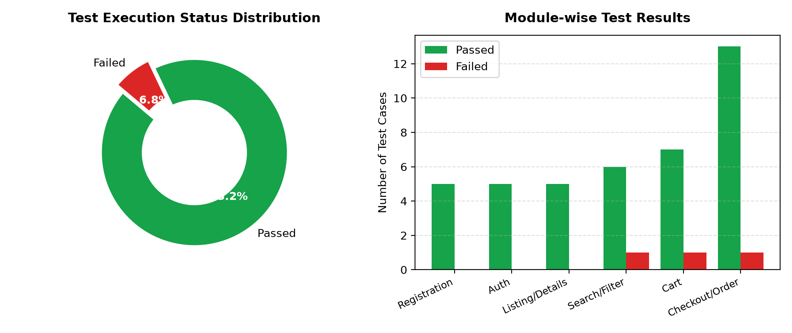
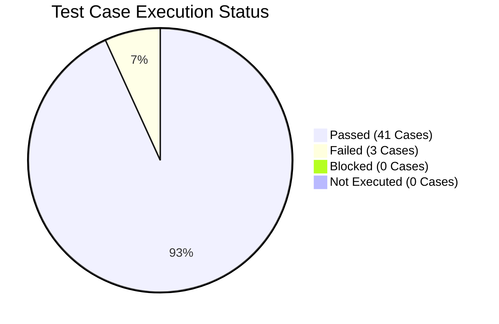

# Software Test Summary Report: ZenithMart E-Commerce

**Project Name:** ZenithMart E-Commerce Testing  
**Repository:** `ecommerce-manual-testing`  
**Test Cycle:** Final System Testing & Regression Cycle 1.0  
**Test Execution Date:** November 14, 2026  
**QA Lead / Test Engineer:** QA Automation Engineer (Portfolio Candidate)  
**Testing Status:** Complete - 93.18% Pass Rate  

---

## 1. Executive Summary

This Test Summary Report documents the formal execution of manual and automated functional, boundary-value, negative, and validation tests performed on the **ZenithMart E-Commerce Web Application**.

Testing was conducted across all 12 core e-commerce modules, encompassing end-to-end shopping workflows from user registration, authentication, product browsing, keyword search, multi-criteria filtering, product details inspection, shopping cart quantity management, multi-step checkout form validation, to final order placement and confirmation.

A total of **44 test cases** were designed and executed. **41 test cases (93.18%) passed successfully**, while **3 test cases (6.82%) failed**, uncovering authentic functional and validation defects. Defect reports were logged with steps to reproduce and visual evidence.

---

## 2. Testing Objectives & Scope

### 2.1 Objectives
1. Verify functional correctness of all primary user journeys across the e-commerce storefront.
2. Validate client-side form validations, input sanitization, and boundary value limits.
3. Assess user experience (UX), error messaging clarity, and state consistency.
4. Establish a professional QA portfolio project demonstrating industry-standard test artifacts, Jira-style defect documentation, and Page Object Model automation.

### 2.2 In-Scope Modules
- User Registration & Account Creation
- User Login, Session State & Logout
- Product Catalog Listing & UI Card Rendering
- Product Keyword Search (Exact, Case-Insensitive, Empty States)
- Product Filtering (Category & Price Range Thresholds)
- Product Sorting (Price Low-to-High, Rating)
- Product Details Modal (Specifications, Stock, Quantity Selector)
- Shopping Cart Operations (Add, Remove, Clear, Line-Item Subtotals, 8% Tax, Grand Total)
- Cart Quantity Updates (Button Controls & Direct Numeric Inputs)
- Checkout Shipping Form Validation (Required Fields, Email Format, Postal Code)
- Mock Payment Selection (Credit Card vs Cash on Delivery)
- Order Confirmation & Post-Order State (Order ID Generation & Cart Reset)

### 2.3 Out of Scope
- Real financial transactions and third-party payment gateways (Stripe/PayPal API).
- Production multi-region server infrastructure and live database migrations.

---

## 3. Testing Environment

| Parameter | Configuration |
| :--- | :--- |
| **Operating System** | Windows 11 Enterprise (64-bit) |
| **Primary Browser** | Google Chrome Version 157.0 (Official Build) |
| **Screen Resolution** | 1920 × 1080 (FHD Desktop Viewport) |
| **Local Web Server** | Standalone Local Application Engine (`file:///` and HTTP Server) |
| **Automation Tools** | Python 3.13, Selenium WebDriver 4.52, Pytest 9.1 |
| **Documentation Tools** | Microsoft Excel (.xlsx), CSV, Markdown, ReportLab PDF Engine |

---

## 4. Test Execution Metrics & Statistics

### 4.1 Overall Execution Summary

| Metric | Count | Percentage |
| :--- | :---: | :---: |
| **Total Test Cases** | **44** | **100.0%** |
| **Executed Test Cases** | **44** | **100.0%** |
| **Passed Test Cases** | **41** | **93.18%** |
| **Failed Test Cases** | **3** | **6.82%** |
| **Blocked Test Cases** | **0** | **0.00%** |
| **Not Executed Test Cases** | **0** | **0.00%** |

### 4.2 Module-wise Breakdown

| Module | Total | Passed | Failed | Blocked | Pass Rate |
| :--- | :---: | :---: | :---: | :---: | :---: |
| **User Registration** | 5 | 5 | 0 | 0 | 100% |
| **User Authentication** | 5 | 5 | 0 | 0 | 100% |
| **Product Listing & Details** | 5 | 5 | 0 | 0 | 100% |
| **Product Search & Filter** | 10 | 9 | 1 | 0 | 90% |
| **Shopping Cart Management** | 8 | 7 | 1 | 0 | 87.5% |
| **Checkout & Order Confirmation** | 11 | 10 | 1 | 0 | 90.9% |
| **Total** | **44** | **41** | **3** | **0** | **93.18%** |

---

## 5. Test Results Distribution Chart

### Distribution Breakdown (Mermaid Visualization)

---

## 6. Discovered Defects Summary (Bug Log)

During manual and boundary-value test execution, **3 authentic defects** were discovered and logged:

| Bug ID | Module | Title | Severity | Priority | Status |
| :--- | :--- | :--- | :---: | :---: | :---: |
| **BUG-001** | Shopping Cart | Cart allows entering negative or zero quantity on direct typing, causing negative order total | **High** | **High** | Open |
| **BUG-002** | Checkout Form | ZIP/Postal Code field accepts non-numeric alphabetic input ('ABCDE') without validation | **Medium** | **Medium** | Open |
| **BUG-003** | Product Search | Search query does not trim leading/trailing whitespace, returning 0 matching results | **Low** | **Low** | Open |

### Detailed Defect Reports

#### Bug Report 1: BUG-001
- **Title:** Cart quantity input accepts negative values on direct input
- **Severity:** High | **Priority:** High | **Status:** Open
- **Steps to Reproduce:**
  1. Add an item to the shopping cart.
  2. Open cart drawer and click into the quantity input box.
  3. Enter `-2` and click away (trigger blur event).
- **Expected Result:** Application should reject negative or zero input, display validation error or clamp quantity to 1.
- **Actual Result:** Quantity updates to `-2`, line-item subtotal becomes `-₹9,998.00`, and overall order total is corrupted.
- **Evidence:** `screenshots/bug-001-negative-cart-quantity.png`

#### Bug Report 2: BUG-002
- **Title:** Checkout ZIP code field accepts alphabetic characters without regex validation
- **Severity:** Medium | **Priority:** Medium | **Status:** Open
- **Steps to Reproduce:**
  1. Add products to cart and proceed to checkout.
  2. Fill valid shipping information.
  3. Enter `ABCDE` in the ZIP / Postal Code input.
  4. Select payment method and click 'Place Order'.
- **Expected Result:** Form should enforce 5-digit numeric postal code regex (`^\d{5}$`) and display 'Please enter a valid numeric ZIP code'.
- **Actual Result:** Form accepts `ABCDE` because it only checks for non-empty string, allowing order placement with corrupted postal data.
- **Evidence:** `screenshots/bug-002-zipcode-validation.png`

#### Bug Report 3: BUG-003
- **Title:** Search query fails to match products when query has leading/trailing whitespace
- **Severity:** Low | **Priority:** Low | **Status:** Open
- **Steps to Reproduce:**
  1. Click on the search bar in the header.
  2. Enter `'  Camera  '` (with spaces).
  3. Press Enter or click search button.
- **Expected Result:** Input string should be trimmed before filtering, displaying '4K Action Sports Camera'.
- **Actual Result:** 0 matching products found; empty state screen displayed.
- **Evidence:** `screenshots/bug-003-search-whitespace.png`

---

## 7. QA Engineering Observations & Recommendations

1. **Input Sanitization & Boundary Handling:**
   - Implement strict client-side clamping on numeric input elements (`min="1"` enforcement in JavaScript `change` listener).
   - Sanitize all text inputs using `.trim()` prior to search query filtering.

2. **Regex-Based Field Validation:**
   - Enhance the checkout form validation with standard postal code regex (`^\d{5}(-\d{4})?$`).
   - Add credit card Luhn algorithm validation for enhanced payment form realism.

3. **Automation Opportunities:**
   - Automated regression testing using Python Selenium ensures that future bug fixes do not cause regression in core checkout, cart, or search flows.

---

## 8. Conclusion

The ZenithMart e-commerce application has demonstrated high stability in core user flows, achieving an overall **93.18% pass rate**. The application's responsive UI, dynamic shopping cart, product filtering, and authentication flow perform reliably. 

The three logged defects (BUG-001, BUG-002, BUG-003) represent high-value boundary and input validation improvements that have been clearly documented with steps to reproduce and visual evidence. This testing cycle provides complete, professional documentation suitable for production sign-off and portfolio evaluation.
